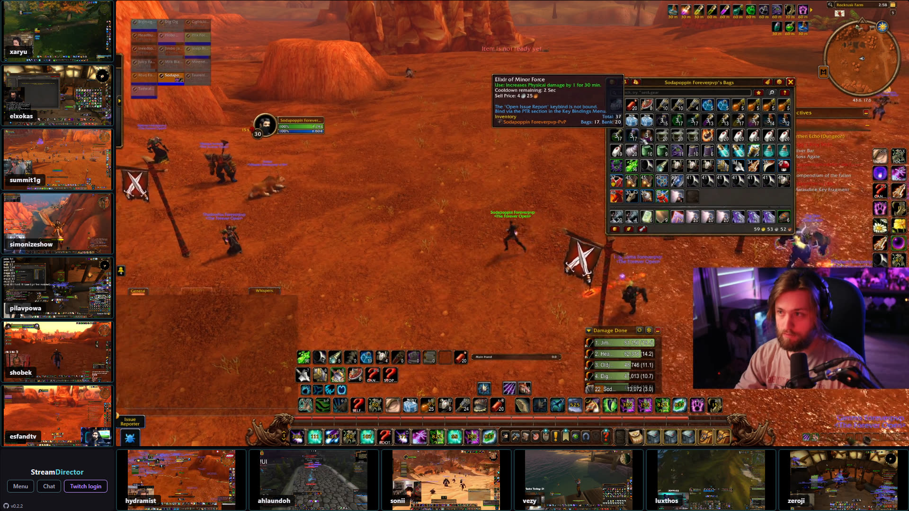

# StreamDirector

Watch many Twitch streams at once and direct which one is in focus — built to be captured in OBS.

StreamDirector shows up to 14 Twitch channels in one 1920×1080 window: one large **focus** stream with sound, the others as small muted **tiles** around it. Switch the focus with a click or the arrow keys and the window becomes your live "director's cut" — ideal for covering events, co-streams or tournaments where many streamers play at the same time.



## Features

- **Multiview** — up to 14 streams in an L-shaped layout made for a 1920×1080 OBS scene
- **Seamless focus switch** — the new focus becomes sharp within ~2 seconds, without picture or sound gaps
- **Efficient** — tiles play in 360p, only the focus in source quality; no heavy Twitch embeds
- **Per-channel volume** — streamers differ in loudness; each channel remembers its own volume
- **Twitch Turbo support** — log in once and all streams play without ads
- **Low latency mode** — optional, plays about 3–4 s closer to live (1.5–5 s behind the broadcast)
- **Followed channels** — everything you follow on Twitch right in the list, live ones on top
- **Live status** — see at a glance which of your channels are streaming
- **Tiny** — a single 2 MB `.exe`, no installation

## Download

Download `StreamDirector-<version>.exe` from the [latest release](https://github.com/stefanpoensgen/stream-director/releases/latest) and run it.

- Requires **Windows 10 or 11**. Everything else (the WebView2 browser engine and .NET Framework 4.8) is part of Windows and updated by Windows Update.
- The app is not code-signed, so Windows SmartScreen may warn on first launch: click **More info** → **Run anyway**.

## Getting started

1. Open the channel list with **Menu** (bottom-left) or `S`; **Hide menu** closes it again.
2. Add channels: type a name and press **+**, or use **Import** to paste a whole list (one per line). Ready-made lists for upcoming events are in the [Discussions](https://github.com/stefanpoensgen/stream-director/discussions).
3. Switch channels on with the toggle next to their name. **LIVE** marks channels that are streaming right now.
4. Click a channel (in the sidebar or a tile) to put it in focus — the focus is the only stream with sound.
5. The channels you follow on Twitch appear in the same list, marked with **♥** — live ones on top (hover for game and viewers). Click **♥ Show followed channels** at the end of the list once and confirm on Twitch — StreamDirector asks only for permission to read your follows. Switch a ♥ channel on to add and start it, or click its name to add it and put it in focus.
6. Hide the sidebar again with `S` before you go live.

## Using it with OBS

1. Start StreamDirector and set up your channels. Keep the window open — a **minimized window cannot be captured**.
2. In OBS, add a source: **+** → **Window Capture**.
3. Window: **[StreamDirector.exe]: StreamDirector**.
4. Capture Method: **Windows 10 (1903 and up)**. Other methods may show a black picture.
5. Keep **Client Area** enabled (default) — the title bar is then not part of the stream.
6. Sound: enable **Capture Audio** in the Window Capture source. You get exactly the focus stream — no system sounds, Discord or other apps.
7. The window content is exactly 1920×1080, so it fills a 1080p canvas without scaling.

Tips for a clean picture:

- Hide the sidebar (`S`) — it is part of the captured picture.
- Move the mouse away from the window: hovering the focus shows its name and volume slider, and these are captured too.
- `F11` switches to borderless fullscreen on the current monitor if you prefer that over a window.
- Resized the window by accident? **Reset window to Full HD** at the bottom of the sidebar brings it back to exactly 1920×1080.

## Controls

| Key       | Action                                    |
| --------- | ----------------------------------------- |
| `←` / `→` | Switch focus to the previous/next channel |
| `↑` / `↓` | Volume of the focus ±5 %                  |
| `M`       | Mute/unmute the focus                     |
| `F`       | Back to the previously focused channel    |
| `S`       | Show/hide the sidebar                     |
| `C`       | Open the chat of the focus                |
| `F11`     | Fullscreen on/off                         |
| `Escape`  | Close the import dialog                   |

Buttons in the bottom-left corner: **Menu** / **Hide menu** (channel list), **Chat** (chat of the focus in a popup) and **Twitch login** / **Twitch logout**.

**Low latency** (switch at the bottom of the sidebar) uses Twitch's low-latency segments like the Twitch website: about 3–4 s less delay, but less buffer — turn it off if streams stutter on your connection.

Hovering the focus shows its name with the resolution actually on screen (e.g. `1080p60`), its volume slider and mute button.

**Volume** is set per channel and remembered: hover the focus for its slider and mute button, use the slider in the sidebar, or press `↑`/`↓` and `M`. Muting keeps the volume; changing the volume unmutes.

## Layout

The layout follows the shape of the window:

- **16:9 (e.g. 1920×1080 for OBS):** an L shape — up to 7 tiles in the left column, the focus top-right, further tiles in the bottom row, logo and buttons bottom-left.
- **Ultrawide (wider than about 2.1:1, e.g. 3440×1440 in fullscreen):** the focus in the middle at full height, tiles alternating left and right of it, logo and buttons at the bottom of the left column.

The layout switches by itself when the window size changes (F11, sidebar, resizing); players keep running.

At most 14 streams play at the same time. Switching on one more stops the one you used longest ago.

## Twitch login and ads

**Twitch login** opens the Twitch login; the window closes by itself once you are logged in and all streams restart with your account. With a **Twitch Turbo** subscription they play without ads. Without a login everything works too, with the usual Twitch ads. **Twitch logout** removes the login again.

## Troubleshooting

| Problem                                   | Solution                                                                                                                                                                                      |
| ----------------------------------------- | --------------------------------------------------------------------------------------------------------------------------------------------------------------------------------------------- |
| No sound in OBS                           | Enable **Capture Audio** in the Window Capture source, and check that the focus is not at 0 % volume.                                                                                         |
| Black picture in OBS                      | Set the capture method to **Windows 10 (1903 and up)** and make sure the window is not minimized.                                                                                             |
| A tile shows **OFFLINE**                  | The channel is not streaming. The player retries every 30 seconds and starts automatically.                                                                                                   |
| A tile shows **UNAVAILABLE**              | The channel is live but cannot be played (subscriber-only or geo-blocked).                                                                                                                    |
| The app does not start                    | The WebView2 runtime is part of Windows 10/11; on very old systems install it from [Microsoft](https://developer.microsoft.com/microsoft-edge/webview2/).                                     |
| Reset everything                          | Close the app and delete `%LOCALAPPDATA%\StreamDirector` (channels, volumes, login).                                                                                                          |
| Channels gone after updating from ≤ 0.0.6 | Versions up to 0.0.6 were a different app technology; their channel list is not carried over. Use **Import** to add the channels again.                                                       |
| Streams stopped working for everybody     | StreamDirector uses Twitch's unofficial web API (the same one [streamlink](https://github.com/streamlink/streamlink) uses). If Twitch changes it, playback can break until an update follows. |

## Development

StreamDirector is a small C# host (`host/`, .NET Framework 4.8 + WebView2) that shows a web frontend (`index.html`, `app.js`, `player.js`, `styles.css`). Building needs the [.NET SDK](https://dotnet.microsoft.com/download) 8 or newer, on Windows or in WSL/Linux; running needs Windows.

```bash
npm install && npm run check   # formatting check (prettier)
dotnet build host              # → host/bin/Debug/net48/StreamDirector.exe
host/bin/Debug/net48/StreamDirector.exe --dev   # with DevTools
```

The frontend files are embedded into the exe, so changes need a `dotnet build` and an app restart. In WSL, build into a Windows folder (`dotnet build host -o /mnt/c/…`) and start it from there — Windows may run a stale cached copy of an exe started from `\\wsl.localhost\…`.

### How it works

```
host/                    C# WebView2 host
  MainForm.cs            Window, popups, F11 fullscreen
  AppRequestHandler.cs   Answers all requests to https://localhost/* in-process
  TwitchClient.cs        Twitch API client (live status, HLS playlists)
  TwitchSession.cs       Login state (WebView2 cookies), logout
  AuthWindow.cs          Twitch window for login / connecting the follows, closes itself when done
  FollowsConnection.cs   Followed channels: own Twitch app (device login) + official API
  AudioRenderer.cs       Plays the relayed player audio from StreamDirector.exe (WASAPI)
  EmbeddedFiles.cs       Single-file support (embedded frontend, WebView2 assemblies and loader)
  NativeMethods.cs       Win32 helpers (icon, dark title bar)
index.html, app.js       Frontend: state, layout, players, volume, hotkeys
player.js                HLS player per channel (360p tile / source focus)
audio-relay.js           Routes player audio via Web Audio to the host
audio-tap.js             AudioWorklet that hands out 10 ms PCM chunks
styles.css               Dark theme, CSS grid layout
vendor/hls.light.mjs     Vendored hls.js
```

- **No web server:** WebView2 hands every request for `https://localhost` to the host, which serves the embedded frontend and a small API. The origin has to be `localhost` — Twitch's playlist servers reject other origins.
- **Playback:** [hls.js](https://github.com/video-dev/hls.js) plays the Twitch HLS streams directly. Quality switches use `hls.nextLevel`, which takes effect at the next 2-second segment while the current one keeps playing — that is why focus switches are seamless. Players stay 4 s behind the newest segment (hls.js would default to 18 s for Twitch's playlists), which puts the picture about 5–9 s behind the broadcast. In low latency mode the media playlists include Twitch's `#EXT-X-TWITCH-PREFETCH` segments (still being produced); `player.js` rewrites them into regular segments (as streamlink does), which saves another 3–4 s.
- **Audio:** WebView2 plays sound from its own helper processes, which OBS's "Capture Audio" does not see as part of the StreamDirector window. So the players' audio goes through Web Audio into an AudioWorklet (WebView2 stays silent), is sent to the host in 10 ms chunks and played by `StreamDirector.exe` itself. Measured cost: 10–20 ms more latency than WebView2's own output.
- **Single file:** frontend, licenses and the WebView2 assemblies are embedded resources. Only the native `WebView2Loader.dll` cannot run from memory; it is written once to `%LOCALAPPDATA%\StreamDirector\WebView2Loader\`.
- **Followed channels:** the website login cannot read follows (Twitch blocks them on its internal API, and the token lacks `user:read:follows`). StreamDirector therefore has its own public Twitch app and asks for exactly that permission via the device code flow; `FollowsConnection.cs` keeps the tokens DPAPI-encrypted in `%LOCALAPPDATA%\StreamDirector\follows.dat` and reads the follows from the official API (Helix: `channels/followed` for all follows, cached 10 min, `streams/followed` for the live ones). Logout also removes this connection.
- **State** (channels, volumes, layout) lives in the WebView2 profile's `localStorage`.

| Endpoint                        | Purpose                                       |
| ------------------------------- | --------------------------------------------- |
| `GET /api/live?channels=a,b`    | Which of the channels are streaming           |
| `GET /api/playlist/<name>.m3u8` | HLS master playlist (with Turbo token if any) |
| `…/<name>.m3u8?lowLatency=1`    | The same with Twitch's prefetch segments      |
| `GET /api/auth`                 | `{ "loggedIn": true/false }`                  |
| `POST /api/logout`              | Drop the Twitch session                       |
| `GET /api/follows`              | `{ connected, channels }` — all follows, live |
| `POST /api/follows/connect`     | Start the Twitch device login for the follows |

### Dependencies

Deliberately minimal: one NuGet package (`Microsoft.Web.WebView2`) and `prettier` for formatting. `hls.js` is vendored (currently **1.6.15**) so it only changes when deliberately updated:

```bash
npm pack hls.js@<version> && tar xzf hls.js-<version>.tgz
cp package/dist/hls.light.mjs vendor/hls.light.mjs
cp package/LICENSE vendor/hls.js.LICENSE
sed -i '/^\/\/# sourceMappingURL=/d' vendor/hls.light.mjs
```

### Release

Push a version tag; a GitHub Action builds the exe and publishes the release. The app version comes from the tag:

```bash
git tag v1.2.3 && git push origin v1.2.3
```

## About

An experimental project, written entirely with [Claude Code](https://claude.ai/code). Licensed under the [MIT License](LICENSE).
